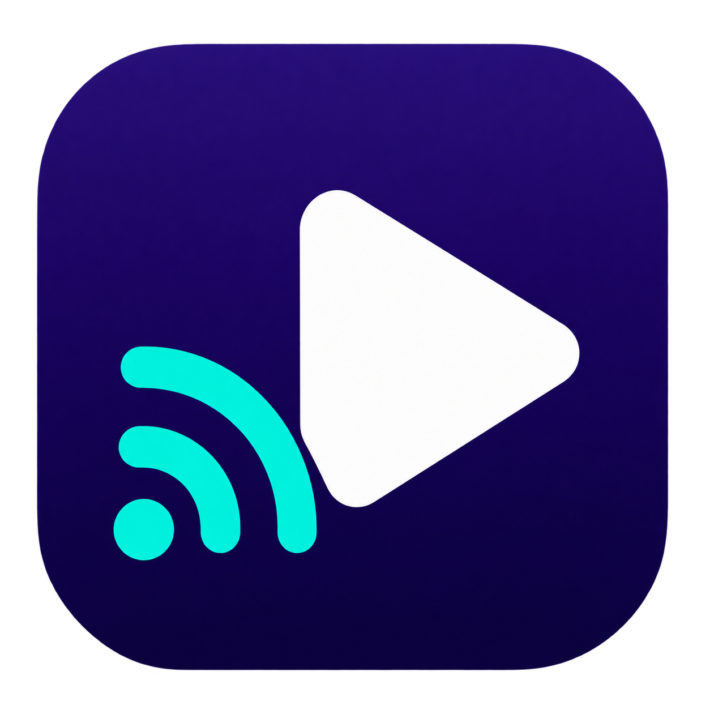

<p align="center">
  
</p>

# Nest Player — Google Nest & Chromecast Audio Player for macOS

[](https://github.com/htlin222/google-nest-as-speaker/releases/latest)
[](https://github.com/htlin222/google-nest-as-speaker/releases/latest)
[](https://github.com/htlin222/google-nest-as-speaker/releases/latest)
[](LICENSE)
[](https://github.com/htlin222/google-nest-as-speaker/stargazers)

**Play local music, podcasts, and video soundtracks from your Mac on Google Nest,
Google Home, and Chromecast-compatible speakers.** Nest Player is a native
SwiftUI media player with playlists, local video playback, and Google Cast audio
output over your local network.

Watch a video on your Mac while its sound plays on a Nest speaker in another
room. Mac audio is muted by default; enable **Mac audio** for simultaneous output
from both devices. A Python CLI is included for scripts and automation.

**[Download for Apple Silicon](https://github.com/htlin222/google-nest-as-speaker/releases/latest)**
· [CLI quick start](#command-line-quick-start)
· [Architecture & specification](SPEC.md)

## Download and install

The prebuilt `.app` requires **macOS 14 Sonoma or later on Apple Silicon
(M1 or newer)**. An Intel binary is not included in this release.

1. Open [Releases](https://github.com/htlin222/google-nest-as-speaker/releases/latest)
   and download `Nest-Player-0.1.0-macOS-arm64.zip`.
2. Extract the ZIP and move **Nest Player.app** to Applications.
3. Open the app and allow local-network access if macOS requests it.
4. Select your Cast speaker, add or drop a media file, then press Play.

The application bundles Python and PyChromecast. You do not need to install
Python or `uv` to run the downloaded app.

**FFmpeg is an additional requirement for video soundtrack extraction and
unsupported audio formats.** With [Homebrew](https://brew.sh/) installed:

```bash
brew install ffmpeg
```

Common Cast-supported audio files can play directly without FFmpeg. The Mac and
speaker must be on the same reachable LAN; guest-network isolation can prevent
discovery or streaming.

### First launch on macOS

This initial release is **ad-hoc signed and not notarized by Apple**. If macOS
blocks the app and you trust this download, attempt to open it, then use
**System Settings → Privacy & Security → Open Anyway**. See
[Apple's instructions for opening downloaded apps](https://support.apple.com/en-us/102445).

Each release includes a SHA-256 file. To verify the download before extracting:

```bash
shasum -a 256 -c Nest-Player-0.1.0-macOS-arm64.zip.sha256
```

## Features

- **Cast local audio:** stream files to Google Nest, Google Home, and Google
  Cast audio groups without uploading them to a cloud service.
- **Local video + Cast sound:** watch supported videos on the Mac while their
  audio plays through the selected speaker.
- **Optional dual audio:** Mac audio starts muted; turn it on when both rooms
  should hear the media.
- **Persistent playlist:** drag and drop, add, remove, reorder, previous/next,
  and automatic advancement after natural completion.
- **Playback controls:** pause, resume, stop, seek, and adjust Cast volume.
- **Fast common-format path:** serve supported audio directly, remux compatible
  video audio tracks, and transcode only when necessary.
- **Conversion cache:** reuse prepared audio with a 2 GB LRU cache budget.
- **Warm service:** one local Cast service remains available while the app runs;
  button presses do not create new Python processes or install dependencies.
- **Automation:** use the CLI, JSON output, or the bundled
  [repo skill](.agents/skills/google-nest-speaker/SKILL.md).

## Media and device support

| Input or target | Behavior |
| --- | --- |
| MP3, M4A, FLAC, Ogg/Opus, WAV | Direct serving for Cast-compatible codecs and containers |
| Video containing AAC or MP3 audio | Extract the audio with FFmpeg stream copy when possible |
| Other FFmpeg-readable audio/video | Convert the audio to MP3 |
| MP4, MOV, M4V video | Local picture playback when supported by AVFoundation |
| Google Nest Mini | Tested on a real device |
| Other Google Home / Cast audio devices and groups | Discovered through PyChromecast; compatibility depends on the receiver |

Actual codec support depends on the receiver; see
[Google Cast supported media](https://developers.google.com/cast/docs/media).
Local video decoding uses AVFoundation, so a file may cast its audio successfully
even when macOS cannot display its picture.

This app sends media files and URLs to Cast. It does not capture system-wide
Mac audio, cast video to a TV, or guarantee sample-accurate dual-output sync.
Cloudflare remote control is a [proposed extension](SPEC.md#9-cloudflare-remote-control-extension),
not part of this release.

## Command-line quick start

The CLI works on macOS and Linux with Python 3.11+, [`uv`](https://docs.astral.sh/uv/),
and FFmpeg when conversion is needed. The native application is macOS-only.

```bash
git clone https://github.com/htlin222/google-nest-as-speaker.git
cd google-nest-as-speaker
uv sync --locked

# Discover speakers, then use the friendly name from the result.
./nest-speaker list
./nest-speaker --device 'Living Room' play /absolute/path/to/song.mp3

# Video files are accepted; only their soundtrack is cast.
./nest-speaker --device 'Living Room' play /absolute/path/to/movie.mp4

# Or play an already-hosted media URL.
./nest-speaker --device 'Living Room' play 'https://example.com/audio.mp3'
```

Keep the local-file `play` command running: its HTTP server supplies the media to
the speaker. Ctrl-C stops playback and cleans up its temporary directory.

```bash
export NEST_SPEAKER_DEVICE='Living Room'
./nest-speaker status
./nest-speaker pause
./nest-speaker resume
./nest-speaker seek 30
./nest-speaker stop
./nest-speaker volume 35

# Structured output for automation.
./nest-speaker --json list

# Optional known host when mDNS discovery needs help; use your device's address.
./nest-speaker --device 'Living Room' --host 192.0.2.10 play ./song.mp3
```

The initial device-name preference is `客廳`; discovery selects available devices
in the app. Override the CLI default with `--device` or `NEST_SPEAKER_DEVICE`.
See `./nest-speaker --help` and `./nest-speaker play --help` for all options.

## Build the macOS app

Install Xcode or the Swift 6 development toolchain, `uv`, and FFmpeg. Build on
the architecture you intend to run; the published ZIP is built for arm64.

```bash
uv sync --locked
./run-player                  # Development build
./scripts/build_app.sh        # Signed dist/Nest Player.app
./scripts/package_release.sh  # Versioned .app ZIP + SHA-256
open 'dist/Nest Player.app'
```

The build freezes the locked Python environment with PyInstaller, generates
the macOS icon, includes dependency license metadata, and ad-hoc signs the
result. No runtime package installer is used by the bundled app. FFmpeg and
FFprobe are resolved separately from the installed system tools.

## Architecture and privacy

```text
SwiftUI app ── JSON-lines IPC ── bundled Cast service ── Google Cast speaker
     │                              │
     └─ AVPlayer: local video       ├─ PyChromecast: discovery + controls
                                    ├─ HTTP: active media + byte ranges
                                    └─ FFmpeg: remux/transcode + disk cache
```

The app remembers its last discovered speakers and keeps a Cast connection
available during use. Playback commands and events carry generation IDs so old
requests cannot revive a stopped session. Completion is matched to the owned
Cast media session; buffering must reach playback before the startup deadline.

Source files stay on the Mac and are fetched over local HTTP by the receiver.
The server exposes the active media file during playback. Treat the LAN as
trusted; this media endpoint is not an authenticated Internet service.
Converted audio is cached under `~/Library/Caches/NestPlayer/media`, keyed by
source path, file size, modification time, and pipeline version. Direct-play
source files are not copied into that cache.

See [SPEC.md](SPEC.md) for behavior, acceptance criteria, architecture, and the
optional future Cloudflare Worker + local-agent design.

## Troubleshooting

- **No speakers:** confirm the same LAN, allow local-network access, check mDNS
  (UDP 5353), disable guest isolation, and use the discovery button again.
- **Preparing audio:** install FFmpeg and FFprobe with `brew install ffmpeg`.
  Video extraction or first-time conversion depends on file size; cached audio
  is reused on subsequent plays.
- **Mac is silent:** this is the default. Enable **Mac audio** for dual output.
- **No local picture:** try an AVFoundation-compatible format such as MP4/MOV.
- **Cast and Mac differ slightly:** Cast is the playback clock; local playback
  is corrected when drift exceeds 750 ms. Separate rooms are the intended use.
- **Download blocked:** follow the first-launch instructions above. The release
  does not have Apple notarization or an automatic updater.

## Tests and contributing

```bash
swift test
uv run python -m unittest discover -s tests -v
bash -n scripts/build_app.sh scripts/package_release.sh run-player nest-speaker
```

The tests cover byte-range delivery, active-file access, direct MP3 playback,
audio extraction, cache reuse, cancellation, stale-session rejection, and the
buffering startup deadline. LAN and audible playback checks require a real
Cast device and are separate from these tests.

Bug reports and contributions are welcome through
[GitHub Issues](https://github.com/htlin222/google-nest-as-speaker/issues) and pull
requests. Include macOS version, Mac architecture, media format, and the visible
error; leave out private media and network credentials.

## Citation

See [CITATION.cff](CITATION.cff), [citation.bib](citation.bib), and the optional
[AMA/APA citation styles](csl/).

```bibtex
@software{lin2026googlenestasspeaker,
  author = {Lin, Hsieh-Ting},
  title = {{Nest Player}: macOS audio player for Google Nest and Chromecast speakers},
  year = {2026},
  url = {https://github.com/htlin222/google-nest-as-speaker},
  version = {0.1.0}
}
```

## License and acknowledgments

Nest Player source is [MIT licensed](LICENSE). Bundled dependencies retain
their own licenses, included in the app's Resources and dependency metadata.
Built with [SwiftUI](https://developer.apple.com/xcode/swiftui/),
[AVFoundation](https://developer.apple.com/av-foundation/),
[PyChromecast](https://github.com/home-assistant-libs/pychromecast), and
[FFmpeg](https://ffmpeg.org/) as an optional external media tool.

Nest Player is an independent project and is not affiliated with or endorsed by
Google. Google Nest, Google Home, Chromecast, and Google Cast are trademarks of
Google LLC.
