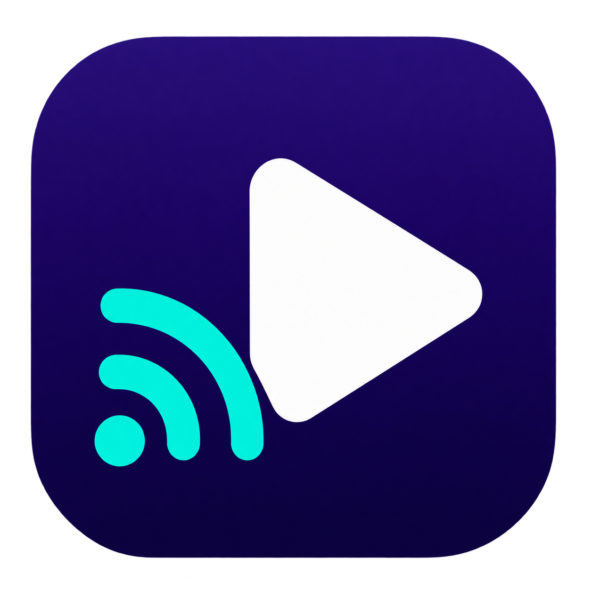
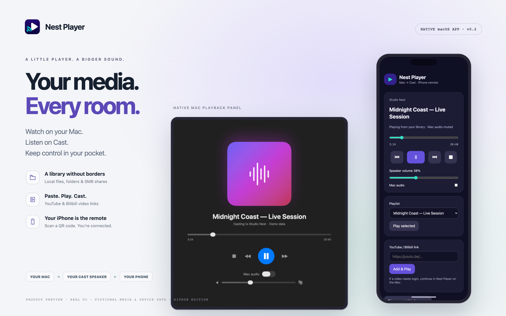
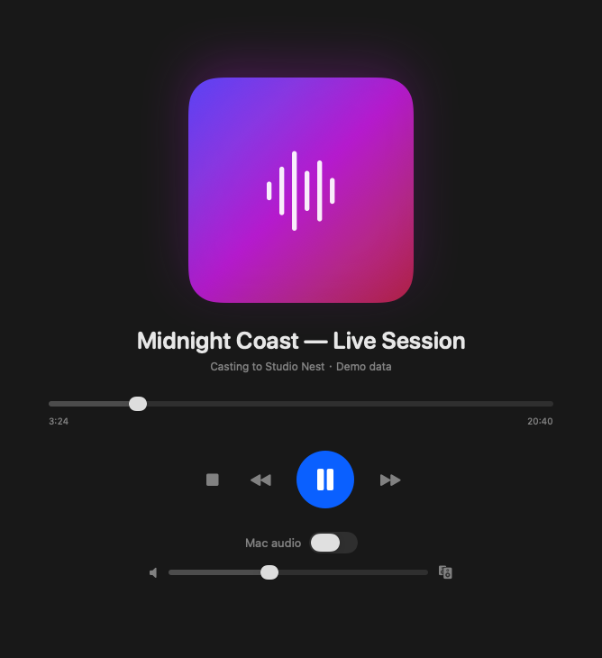
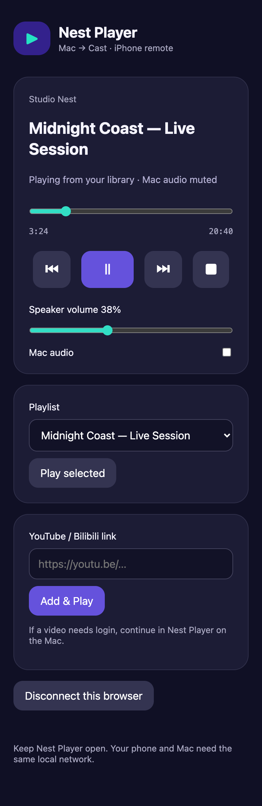

<p align="center"><a href="README.md">English</a> · <strong>繁體中文（台灣）</strong></p>

<p align="center">
  
</p>

# Nest Player — macOS 的 Google Nest 與 Chromecast 音訊播放器

[](https://github.com/htlin222/google-nest-as-speaker/releases/latest)
[](https://github.com/htlin222/google-nest-as-speaker/releases/latest)
[](https://github.com/htlin222/google-nest-as-speaker/releases/latest)
[](LICENSE)

**把 Mac 上的音樂、Podcast 與影片聲音，播放到 Google Nest、Google Home 或相容的 Google Cast 喇叭。**
Nest Player 是使用 SwiftUI 製作的原生 macOS 播放器，支援播放清單、本機影片、SMB 網路資料夾，以及 iPhone 瀏覽器遙控。

貼上 **YouTube／Bilibili 連結**即可加入播放。在 Mac 看影片，讓另一個房間的 Nest 播放聲音；想同時聽到 Mac 的聲音時，再開啟 **Mac audio**。程式也提供 Python 命令列工具，方便自動化。

**[下載 Apple Silicon 版本](https://github.com/htlin222/google-nest-as-speaker/releases/latest)**
· [命令列快速開始](#命令列快速開始)
· [架構與規格](SPEC.md)



*圖片展示 GitHub 版，媒體名稱與裝置資料皆為虛構。手機控制頁由 Playwright 擷取實際介面；Mac 畫面使用隔離的示範資料，不會存取你的播放清單或 Cast 裝置。[截圖來源與重製方式](docs/screenshots/README.md)。*

## 介面一覽

| macOS 原生播放面板 | iPhone 瀏覽器遙控器 |
| --- | --- |
|  |  |

在 Mac 選擇媒體、將音訊送往 Cast 喇叭，再用手機控制同一個播放工作階段。展示圖不包含真實帳號、NAS 位址、私人媒體或有效配對憑證。目前尚未宣布 Mac App Store 上架。

## 下載與安裝

預先編譯的 `.app` 適用於 **Apple Silicon（M1 或更新）與 macOS 14 Sonoma 以上版本**。目前 Release 未提供 Intel 執行檔。

1. 前往 [Releases](https://github.com/htlin222/google-nest-as-speaker/releases/latest)，下載 `Nest-Player-0.2.0-macOS-arm64.zip`。
2. 解壓縮，將 **Nest Player.app** 移到「應用程式」。
3. 開啟程式；若 macOS 詢問，允許區域網路存取。
4. 選擇 Cast 喇叭，加入或拖入媒體檔，按下播放。

下載版已內含 Python 與 PyChromecast，執行時不需要另外安裝 Python 或 `uv`。

**影片音軌擷取與不支援格式的轉換需要 FFmpeg。** 已安裝 [Homebrew](https://brew.sh/) 時，可執行：

```bash
brew install ffmpeg
```

常見的 Cast 相容音訊可直接播放，不需要 FFmpeg。Mac 與喇叭必須位於可互相連線的區域網路；訪客 Wi-Fi 的裝置隔離功能可能阻擋探索或串流。

### macOS 首次開啟

目前 GitHub 下載版採用 **ad-hoc 簽章，尚未通過 Apple 公證**。若 macOS 阻擋且你信任此下載來源，先嘗試開啟程式，再到「系統設定 → 隱私權與安全性 → 強制打開」。請參考 [Apple 的下載程式開啟說明](https://support.apple.com/en-us/102445)。

每個 Release 均附 SHA-256 校驗檔，可在解壓縮前驗證：

```bash
shasum -a 256 -c Nest-Player-0.2.0-macOS-arm64.zip.sha256
```

## 功能

- **YouTube／Bilibili**：貼上影片網址或分享文字；支援短網址，Cast 播放音訊，Mac 可預覽最高 720p 的 H.264 影片串流。
- **瀏覽器登入授權**：需要帳號時，在原網站與你選擇的瀏覽器完成登入，再明確授權程式使用該工作階段。
- **本機資料夾與 SMB**：從資料夾或 Finder 掛載的網路共享匯入媒體，背景掃描、自然排序，離線項目仍保留。
- **iPhone 遙控器**：掃 QR Code，或在瀏覽器輸入 Mac 的配對碼；控制播放、進度、音量、播放清單與網站連結。
- **Cast 本機音訊**：將檔案播放到 Google Nest、Google Home 與 Google Cast 音訊群組，本機檔案不需上傳雲端。
- **本機影片＋Cast 聲音**：Mac 顯示支援的影片，聲音由選定喇叭播放。
- **雙音訊輸出**：Mac 預設靜音；開啟 **Mac audio** 後，Mac 與 Cast 可同時輸出。
- **持久化播放清單**：拖放、加入、移除、排序、上一首／下一首，以及自然播畢後自動接續。
- **完整控制**：暫停、繼續、停止、跳轉進度與 Cast 音量。
- **快速媒體處理**：相容格式直接播放；可直接複製的音軌不重新編碼，必要時才轉檔。
- **轉換快取**：重用處理過的音訊，採用 2 GB 的 LRU 快取預算。
- **單一常駐服務**：App 開啟時維持一個 Cast 服務；按鈕操作不會各自啟動 Python 或安裝套件。
- **自動化**：提供 CLI、JSON 介面與[儲存庫內的 Cast skill](.agents/skills/google-nest-speaker/SKILL.md)。

## 貼上 YouTube／Bilibili 連結

將網址貼到側欄後按 Return，或點 **Paste & Play**。點 **Add** 只會加入佇列，不會立即播放。播放清單取得焦點時也可用 Cmd-V。支援含有網址的分享文字與多個連結，重複影片會被忽略；含 YouTube 播放清單參數的影片只加入該支影片。

`yt-dlp` 與 EJS 腳本已內含。YouTube 另需 JavaScript 執行環境，建議使用 Deno；也支援 Node 22 以上版本：

```bash
brew install deno
```

程式會解析串流，透過支援 Range 的本機代理播放，不必先下載整支影片。完整收到的串流回應會使用獨立的 **512 MB 磁碟快取預算**。CDN 網址可能到期；若串流失效，可停止後重新播放，取得新網址。

### 網站要求登入時

1. 解析器回報需要帳號時，App 會顯示 **Sign in** 視窗；也可對網站項目按右鍵選擇登入。
2. 選擇已安裝的瀏覽器，按 **Open in browser**，在網站完成原本的登入、Google 登入、Bilibili QR 登入或雙重驗證。
3. 回到 App，按 **Use Session & Play**。這一步才授權程式讀取該瀏覽器的 Cookie；macOS 可能詢問鑰匙圈或檔案存取權限。
4. 可選擇只在本次 App 開啟期間，記住該網站使用的瀏覽器。**Forget Website Browser Access** 可清除後續播放的授權選擇。

程式不收集帳號密碼，也不將瀏覽器 Cookie 持久化。公開影片會先嘗試不使用登入資訊。登入不會解除會員、地區、年齡或其他存取限制。目前未支援直播與整個頻道／播放清單匯入；網站改版可能需要更新 yt-dlp。

## 本機資料夾與 SMB 共享

本機資料夾使用 **Add → Add Folder…**；網路資料夾使用 **Add → Connect SMB Folder…**，例如 `smb://nas/media`。掛載、登入與可選擇的鑰匙圈儲存由 Finder 處理，完成後按 **Choose Mounted Folder…**。

背景掃描會遞迴尋找已知音訊／影片副檔名、略過隱藏檔與符號連結、自然排序並排除重複路徑。每次最多掃描 10,000 個檔案，可隨時取消。播放時請維持共享掛載；NAS 離線時，項目會留在播放清單，重新連線後即可重試。Nest Player 不輸入或儲存 SMB 密碼。

## iPhone 瀏覽器遙控與 QR 配對

1. 讓 Mac 與 iPhone 連到可互相連線的區網／Wi-Fi。
2. 在 Mac 工具列點 **Phone Remote**。
3. 用 iPhone 相機掃 QR Code，開啟已配對的控制頁。
4. 也可在 Safari 輸入 App 顯示的 `http://<Mac區網IP>:8989/`，再輸入 Mac 顯示的六位數配對碼。

控制頁支援播放／暫停／停止、上一首／下一首、進度跳轉、Cast 音量、Mac 音訊、播放清單選擇，以及 YouTube／Bilibili 的 **Add & Play**。網站登入與 SMB 掛載在 Mac 完成。

服務優先使用 8989 埠；若已被使用，會選擇其他可用埠，請以 App 顯示的實際網址為準。QR 連結包含本次 App 工作階段的控制權杖，手動配對有嘗試次數限制。Mac 需保持喚醒、App 需保持開啟，防火牆也需允許區網連線。這是區網 HTTP 遙控器；Cloudflare 遠端存取仍是另外規劃的功能。

## 媒體與裝置支援

| 輸入或裝置 | 處理方式 |
| --- | --- |
| MP3、M4A、FLAC、Ogg/Opus、WAV | 編碼與容器符合 Cast 要求時，直接提供串流 |
| 含 AAC／MP3 音軌的影片 | 可行時使用 FFmpeg 複製音軌，不重新編碼 |
| 其他 FFmpeg 可讀取的影音 | 將音訊轉成 MP3 |
| MP4、MOV、M4V | AVFoundation 支援時，在 Mac 顯示畫面 |
| Google Nest Mini | 已使用真實裝置測試 |
| 其他 Google Home／Cast 音訊裝置與群組 | 由 PyChromecast 探索；相容性依接收裝置而定 |

實際編碼支援依接收裝置而定，請參考 [Google Cast 支援的媒體格式](https://developers.google.com/cast/docs/media)。本機畫面由 AVFoundation 解碼，因此可能出現「Cast 聲音可播，但 macOS 無法顯示該影片」的情況。

本程式播放媒體檔或網址，不擷取整個 Mac 的系統音訊、不向電視投放影片，也不保證雙輸出達到取樣等級同步。[Cloudflare 控制擴充](SPEC.md#9-cloudflare-remote-control-extension)不包含在目前版本。

## 命令列快速開始

CLI 可在 macOS 與 Linux 使用，需要 Python 3.11 以上、[`uv`](https://docs.astral.sh/uv/)，以及轉換媒體時所需的 FFmpeg。原生 App 僅支援 macOS。

```bash
git clone https://github.com/htlin222/google-nest-as-speaker.git
cd google-nest-as-speaker
uv sync --locked

# 先找出裝置，再使用結果中的名稱。
./nest-speaker list
./nest-speaker --device '客廳' play /absolute/path/to/song.mp3

# 影片只將音軌送到 Cast。
./nest-speaker --device '客廳' play /absolute/path/to/movie.mp4

# 已託管的媒體網址。
./nest-speaker --device '客廳' play 'https://example.com/audio.mp3'
```

本機檔案播放期間，請保持 `play` 指令執行；Nest 會從它的 HTTP 伺服器讀取媒體。按 Ctrl-C 可停止播放並清理暫存目錄。

```bash
export NEST_SPEAKER_DEVICE='客廳'
./nest-speaker status
./nest-speaker pause
./nest-speaker resume
./nest-speaker seek 30
./nest-speaker stop
./nest-speaker volume 35

# 自動化可用 JSON。
./nest-speaker --json list

# mDNS 需要協助時，可指定實際裝置位址；下列為文件用範例。
./nest-speaker --device '客廳' --host 192.0.2.10 play ./song.mp3
```

初始偏好的裝置名稱是 `客廳`；App 會探索可用裝置。CLI 可用 `--device` 或 `NEST_SPEAKER_DEVICE` 覆寫預設值。完整選項請見 `./nest-speaker --help` 與 `./nest-speaker play --help`。

## 建置 macOS App

安裝 Xcode 或 Swift 6 開發工具鏈、`uv` 與 FFmpeg，並在目標架構上建置。公開 ZIP 為 arm64 版本。

```bash
uv sync --locked
./run-player                  # 開發版
./scripts/build_app.sh        # 簽署 dist/Nest Player.app
./scripts/package_release.sh  # 版本化 ZIP 與 SHA-256
open 'dist/Nest Player.app'
```

建置時使用 PyInstaller 凍結鎖定的 Python 環境、產生 macOS 圖示、附上第三方授權，並執行 ad-hoc 簽署。打包版不會在執行時安裝 Python 套件；FFmpeg／FFprobe 則使用另外安裝的系統工具。

## 架構與隱私

```text
SwiftUI App ── JSON-lines IPC ── 內建 Cast 服務 ── Google Cast 喇叭
     │                               │
     └─ AVPlayer：本機畫面            ├─ PyChromecast：探索與控制
                                     ├─ HTTP：媒體與 byte ranges
                                     └─ FFmpeg：音軌處理與快取
```

App 記住上次探索到的喇叭，並維持可用的 Cast 連線。播放命令與事件帶有 generation ID，避免舊請求讓已停止的工作階段復活；完成事件也需符合目前擁有的 Cast session。BUFFERING 必須在期限內真正進入播放。

本機來源檔留在 Mac，由接收端透過區網 HTTP 讀取，伺服器只提供本次媒體。請將區網視為受信任環境；此媒體端點不是對外的認證服務。轉換音訊放在 `~/Library/Caches/NestPlayer/media`，以來源路徑、大小、修改時間與處理管線版本判定快取；直接播放的來源檔不複製進快取。

完整行為、驗收條件與未來 Cloudflare Worker＋本機代理設計請見 [SPEC.md](SPEC.md)。

## 疑難排解

- **找不到喇叭**：確認相同區網、允許區網存取、檢查 mDNS（UDP 5353）與訪客隔離，再按探索按鈕。
- **準備音訊中**：安裝 FFmpeg／FFprobe；首次擷取或轉檔時間取決於檔案大小，後續會重用快取。
- **YouTube 無法解析**：安裝 Deno，確認影片本身可存取；網站改版時可能需更新 yt-dlp。
- **Mac 沒聲音**：這是預設行為，需要雙輸出時開啟 **Mac audio**。
- **Mac 沒畫面**：嘗試 AVFoundation 支援的 MP4／MOV 編碼。
- **手機無法連線**：檢查相同 Wi-Fi、Mac 是否喚醒、防火牆與 App 顯示的實際網址／埠。
- **NAS 檔案不能讀**：先在 Finder 重新掛載，再重試清單項目。
- **Mac 與 Cast 略有時間差**：Cast 是主要時鐘，本機偏移超過 750 毫秒時會校正，預期用途為不同房間。
- **下載版被阻擋**：依前述首次開啟流程處理；目前尚無 Apple 公證或自動更新。

## 測試與貢獻

```bash
swift test
uv run python -m unittest discover -s tests -v
bash -n scripts/build_app.sh scripts/package_release.sh run-player nest-speaker

# 選用：解析公開網站與讀取串流，不播放聲音。
uv run python scripts/smoke_online.py

# 選用：驗證打包版服務、手機控制 IPC 與網站解析。
uv run python scripts/smoke_bundle.py \
  'dist/Nest Player.app/Contents/Resources/nest-service/nest-service' --online
```

測試涵蓋 Range 傳輸、檔案存取限制、MP3 直接播放、音軌擷取、快取、取消操作、舊 session 拒絕、BUFFERING 逾時、資料夾掃描、播放清單保存與手機配對。區網與實際聲音檢查需要真實 Cast 裝置。

歡迎透過 [GitHub Issues](https://github.com/htlin222/google-nest-as-speaker/issues) 與 Pull Request 回報問題或貢獻。請附 macOS 版本、Mac 架構、媒體格式與錯誤訊息，避免提供私人媒體或網路憑證。

## 引用

請參考 [CITATION.cff](CITATION.cff)、[citation.bib](citation.bib) 及 [AMA／APA 格式檔](csl/)。

```bibtex
@software{lin2026googlenestasspeaker,
  author = {Lin, Hsieh-Ting},
  title = {{Nest Player}: macOS audio player for Google Nest and Chromecast speakers},
  year = {2026},
  url = {https://github.com/htlin222/google-nest-as-speaker},
  version = {0.2.0}
}
```

## 授權與致謝

原始碼採用 [MIT 授權](LICENSE)；第三方套件仍依各自授權，相關文字隨 App Resources 與套件 metadata 提供。使用 [SwiftUI](https://developer.apple.com/xcode/swiftui/)、[AVFoundation](https://developer.apple.com/av-foundation/)、[PyChromecast](https://github.com/home-assistant-libs/pychromecast)、[yt-dlp](https://github.com/yt-dlp/yt-dlp#embedding-yt-dlp)，並可搭配外部 [FFmpeg](https://ffmpeg.org/)。YouTube 執行環境需求依 [yt-dlp EJS 指南](https://github.com/yt-dlp/yt-dlp/wiki/EJS)。

Nest Player 是獨立專案，與 Google 無隸屬或背書關係。Google Nest、Google Home、Chromecast 與 Google Cast 為 Google LLC 的商標。
