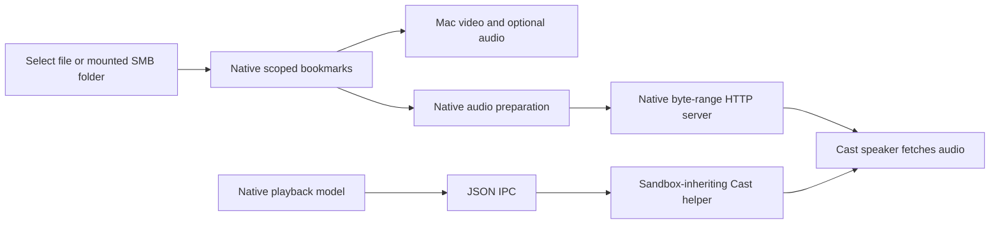

# Sandboxed engineering build

This target prepares for Mac App Store distribution. It has not been submitted;
a development archive is not a distribution export. Community releases still
use `scripts/build_app.sh`.

## Reproduce

Requirements: Xcode 26.6 with command-line tools selected, XcodeGen 2.46.0, uv,
and a local Apple signing identity. Initial target: Apple silicon, macOS 14+.
Packaging automatically obtains the digest-pinned Python 3.12.16 runtime and
uses an isolated environment under `.build`; the first build needs network
access. Global Python and the normal development `.venv` remain separate.

```bash
export NEST_SIGN_IDENTITY='Apple Development'
export NEST_DEVELOPMENT_TEAM='YOUR_TEAM_ID'
bash scripts/build_store.sh
```

The script freezes locked dependencies into `NestCastService.app`, generates
icons and the Xcode project, signs embedded code before Xcode copies it, builds
the native app, and verifies the complete signature. Post-build resource signing
can invalidate incremental outer signatures. Helper inputs are fingerprinted;
changed scripts or lockfiles trigger a fresh freeze. Generated files are ignored.
The build also generates [dependency notices and source archives](dependencies.md)
and runs `scripts/verify_store_bundle.py` on the signed product.

For a Release archive:

```bash
NEST_ACTION=archive bash scripts/build_store.sh
```

Development signing is suitable for local checks. Store export/upload still
needs the account's distribution configuration, provisioning and confirmed App
Store Connect record. Neither command uploads anything.

## Runtime boundary



Native file grants remain active until shutdown. Bookmarks resolve on demand,
without reopening the whole library during launch. Offline SMB bookmarks and
playlist records remain stored; reconnect in Finder and reselect when needed.

The engineering Store helper receives an opaque HTTP capability, not a selected
filesystem path. It advertises the native server on the interface used to reach
the Cast device. This avoids assuming that a persistent child inherits file
grants acquired after its launch.

MP3, FLAC, WAV and supported Ogg use direct serving. M4A is inspected before
direct serving: 44.1/48 kHz AAC with one or two channels can pass through.
Other containers use audio-only AAC passthrough when compatible; otherwise an
AVFoundation reader resamples to 48 kHz and streams bounded PCM buffers into the
system AAC writer. Mono stays mono; other inputs become stereo. This avoids
whole-file PCM allocation and retains completed conversions in the cache.
Video stays on the Mac. Format coverage needs real-file testing; macOS does not
necessarily decode every community FFmpeg format.

The server exposes one random path, supports GET/HEAD and single byte ranges,
rejects other paths, limits clients/headers, and sends one 64 KiB chunk per
client at a time. Stop, replacement, completion and shutdown close the endpoint.

Conversions use a path/size/modification-time/version cache key. Zero-byte cache
entries are rebuilt and replaced. Completed
outputs are pruned by last use toward 2 GiB, preserving the current item even if
it alone exceeds the budget. Cancellation removes its partial output and stops
writer finalization through serialized finish/cancel admission;
crash-left partial-file cleanup still needs hardening.

## Verification and limits

```bash
swift test
source scripts/build_environment.sh
uv run --locked python -m unittest discover -s tests -v
'.build/StoreDerived/Build/Products/Debug/Nest Player.app/Contents/MacOS/NestPlayer' --service-smoke
```

The explicit DEBUG-only probe runs in the actual signed sandboxed app. It starts
the bundled service, fetches the phone controller, generates a tiny silent CAF
inside its container, exports/caches audio, and fetches a native byte range.
It also compares the running helper's Python/OpenSSL/Expat versions with the
packaged inventory.
That command never discovers a speaker, plays Cast audio, or changes volume.
Two separate DEBUG-only probes allow explicit LAN acceptance:

```bash
# Discovers the expected speaker without playing anything.
'.build/StoreDerived/Build/Products/Debug/Nest Player.app/Contents/MacOS/NestPlayer' \
  --service-network-smoke --expected-speaker 'YOUR_SPEAKER_NAME'
# Requires the explicitly named receiver to be idle; plays five seconds of zeros.
'.build/StoreDerived/Build/Products/Debug/Nest Player.app/Contents/MacOS/NestPlayer' \
  --cast-silence-smoke --expected-speaker 'YOUR_SPEAKER_NAME'
```

The silence probe starts with a 22.05 kHz mono CAF, prepares/caches it, serves it
through the native HTTP endpoint and requires receiver PLAYING then FINISHED.
It checks volume before and after and never sends a volume command. Occupied
receivers fail preflight. Opt-in diagnostics report protocol state/error enums
and HTTP byte counts without media URLs, paths, metadata or device addresses.
Release builds omit these probes.

Verified on 2026-11-03: community Release compilation, signed sandboxed
development Release archive, and sandbox probe (about 2 seconds on this Mac).
Physical sandboxed discovery and synthetic silent playback also passed. An
initial 22.05 kHz AAC export failed with receiver MEDIA_DECODE (102); merely
moving MP4 metadata or changing HTTP completion/MIME did not fix it. Both mono
and stereo 48 kHz exports completed, and the original low-rate CAF now completes
after normalization. This is a narrow format regression check, not broad media
acceptance. Automated tests cover low-rate CAF/existing-M4A normalization,
compatible-M4A direct reuse, range boundaries, HTTP access isolation, audio-only
export, cache behavior, bookmark persistence/relocation/offline handling, and a
real Foundation bookmark round trip. Video-fixture generation uses development
FFmpeg; the native production pipeline does not invoke it.

Still required: actual selected-file/drag/drop grants after restart, real SMB
and user-media Cast acceptance, phone browser pairing, broad format/cancellation testing,
remaining distribution/license review, final privacy declarations and Store export validation.
Website extraction/login scope remains undecided; resolve it before claiming
readiness for review.

## Sources

- [Apple: App Sandbox](https://developer.apple.com/documentation/security/app-sandbox)
- [Apple: Embedding a command-line tool](https://developer.apple.com/documentation/xcode/embedding-a-helper-tool-in-a-sandboxed-app)
- [Apple: NWListener](https://developer.apple.com/documentation/network/nwlistener)
- [Apple: AVAssetExportSession](https://developer.apple.com/documentation/avfoundation/avassetexportsession)
- [Apple: AVAssetReaderAudioMixOutput settings](https://developer.apple.com/documentation/avfoundation/avassetreaderaudiomixoutput/init(audiotracks:audiosettings:))
- [Apple: AVAssetWriterInput settings](https://developer.apple.com/documentation/avfoundation/avassetwriterinput/init(mediatype:outputsettings:))
- [Google: Cast receiver error codes](https://developers.google.com/cast/docs/web_receiver/error_codes)
- [PyInstaller 6.22.0: Spec files and bundles](https://pyinstaller.org/en/v6.22.0/spec-files.html)
- [XcodeGen 2.46.0: Project specification](https://github.com/yonaskolb/XcodeGen/blob/2.46.0/Docs/ProjectSpec.md)
